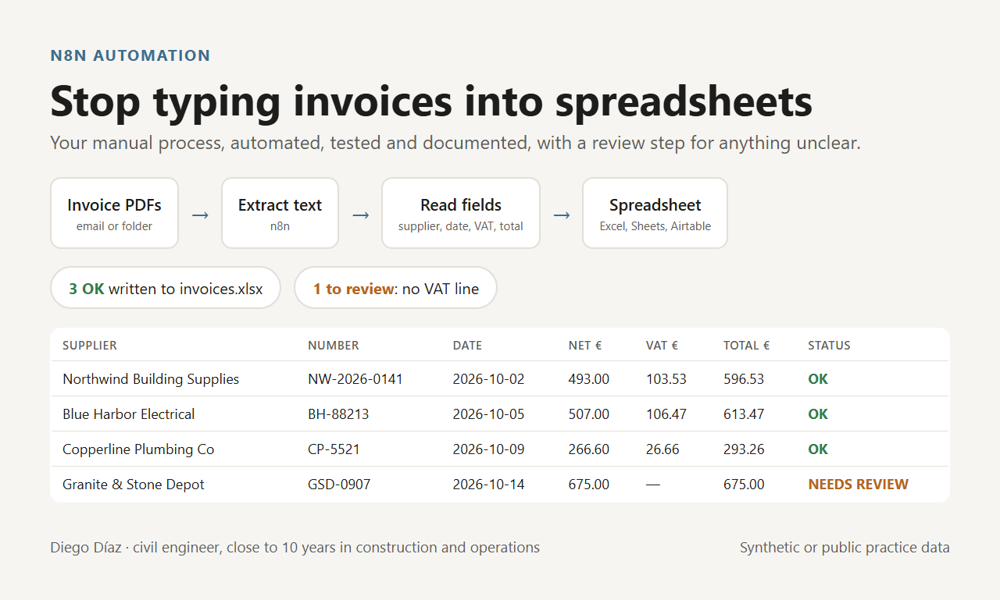
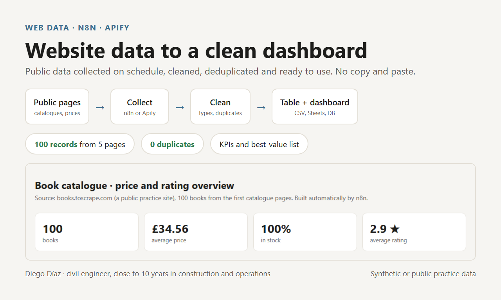
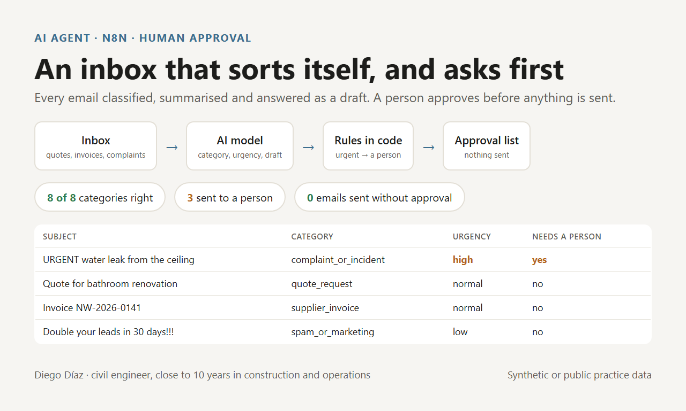

# Automation portfolio · Diego Díaz

I build automations that remove manual work from small businesses: n8n workflows, data from websites and documents, and AI agents where they actually save time.

Before automation I spent close to 10 years in construction, site management and operations (civil engineer, UPC Barcelona). So I start from the process, not the tool: what comes in, what has to come out, who checks it, and what happens when something fails.

Every demo below runs end to end, has tests, and uses **synthetic data or a public site built for scraping practice**, never real client data.

## Demos

### [01 · Supplier invoices (PDF) to a spreadsheet](demo-01-invoice-to-sheet/)

n8n reads invoice PDFs, extracts supplier, number, date, net, VAT and total, writes a spreadsheet, and sends incomplete invoices to a review list with the reason in plain words.

### [02 · Website data to a clean table and a dashboard](demo-02-web-data-dashboard/)

n8n collects 5 pages of a public practice catalogue, cleans and deduplicates 100 records, and builds a table and a dashboard with totals, averages and a best-value list.

### [03 · Email triage agent with human approval](demo-03-email-triage-agent/)

An AI model sorts each email (quote request, complaint, supplier invoice, scheduling, admin, spam), rates urgency and drafts a reply. Rules in code send complaints and urgent emails to a person, and nothing is sent without approval. 8 of 8 categories right on the test emails.

## How I work

1. **A short written plan before I start:** what comes in, what has to come out, and what "done" means.
2. **A working automation**, tested with your real case and with the cases that must not pass.
3. **Documentation and a short video**, so your team can run it without me.
4. **Your data and credentials stay in your accounts.** I build with test data; you add your keys.

All in writing, in English or Spanish.

## Contact

Through my Fiverr or Upwork profile.
