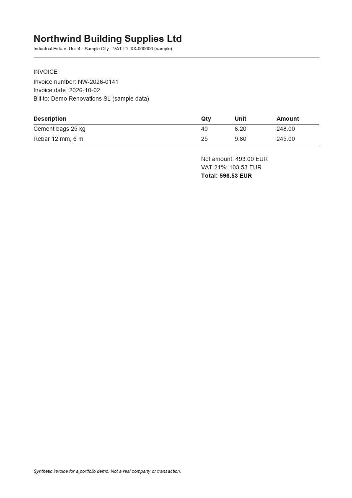
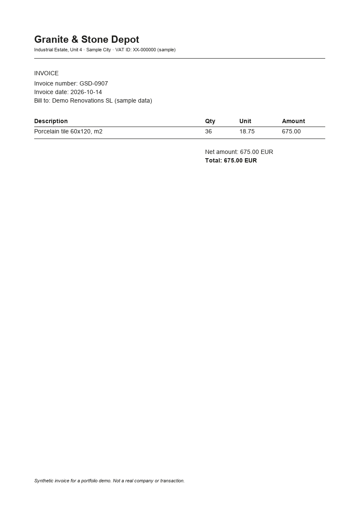
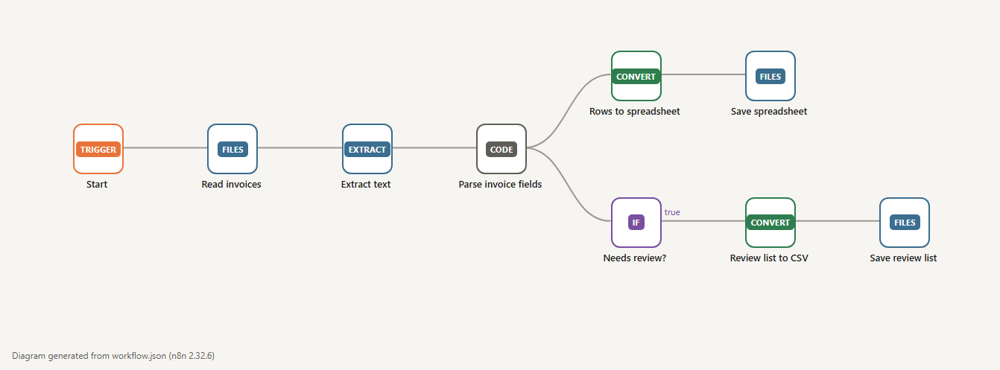
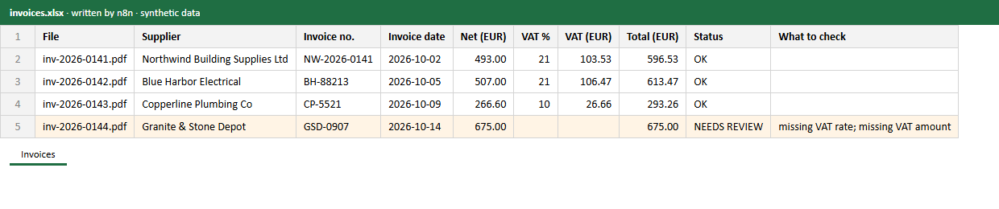

# Demo 01 · Supplier invoices (PDF) to a spreadsheet, with a review list

**The problem:** someone in the office opens every supplier invoice and types supplier, number, date, net, VAT and total into a spreadsheet. It is slow, and mistakes only show up at month end.

**What this n8n workflow does:** reads the PDFs, pulls out the fields, writes one spreadsheet row per invoice, and puts anything incomplete on a review list. **A person checks those; nothing is guessed.**

## 1 · What goes in

Four supplier invoices as PDF. All invented: companies, numbers and amounts come from [`make_samples.py`](make_samples.py). One of them (Granite & Stone Depot) has no VAT line on purpose.

 

## 2 · The workflow



1. **Read invoices**: every PDF in the folder.
2. **Extract text** from each PDF.
3. **Parse invoice fields**: supplier, invoice number, date, net amount, VAT rate, VAT amount and total. If a field is missing, or net + VAT does not equal the total, the invoice is marked `NEEDS REVIEW` and the reason is written in plain words.
4. **All rows** go to `invoices.xlsx`. **Rows to review** also go to `needs-review.csv`.

## 3 · What comes out



3 invoices OK and 1 to review: *missing VAT rate; missing VAT amount*. The real files are [`invoices.xlsx`](example-output/invoices.xlsx) and [`needs-review.csv`](example-output/needs-review.csv).

## What it saves (estimate)

Typing one invoice by hand takes about 2–3 minutes. At 200 invoices a month that is roughly 7–10 hours of data entry. With this workflow, that time goes to checking the few invoices on the review list. *This is an estimate for illustration, not a measured client result.*

## In a real project

- The trigger is usually a mailbox (Gmail or Outlook: "new email with a PDF attachment") or a shared folder.
- The destination is the client's Google Sheet, Excel in OneDrive, Airtable or accounting software.
- Invoices with irregular layouts get an AI extraction step (Claude or OpenAI, with the client's own API key) instead of fixed patterns. The review list stays.
- Credentials are added by the client in their own n8n. They never go into the workflow file.

## How it was tested

- `test.js`: 8 checks on the parser, including the cases that must go to review, plus a check of the last real n8n run. Broken versions of the parser (mutants) make the tests fail, so the tests do catch mistakes.
- The amounts in the spreadsheet were recomputed by hand from the invoice lines.

## Run it yourself

Needs Docker, Node and Python with `reportlab` and `pillow`. From the repo root:

```bash
python demo-01-invoice-to-sheet/make_samples.py   # sample PDFs + PNG previews
sh demo-01-invoice-to-sheet/run-local.sh           # builds workflow.json and runs it in a throwaway n8n container
node demo-01-invoice-to-sheet/test.js              # parser tests + check of the last n8n run
node tools/render-visuals.js                       # workflow diagram and spreadsheet preview images
```

The container has no network access and can only touch `/demo`. Tested with n8n 2.32.6.

`workflow.json` is generated by `build-workflow.js` from `parse-invoice.js`. Edit those two, not the JSON. You can import `workflow.json` into any n8n instance (Workflows → Import from file).
