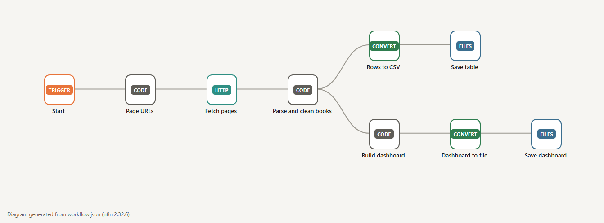
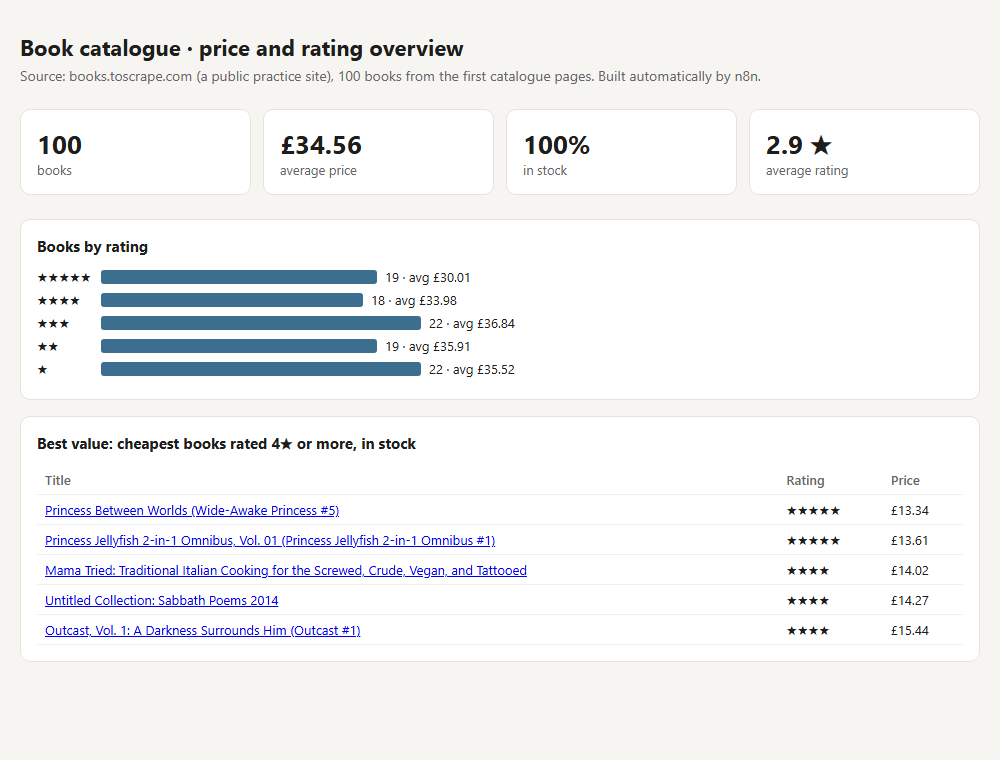

# Demo 02 · Web data to a clean table and a dashboard

**The problem:** someone copies prices, products or listings from websites into a spreadsheet by hand, every week, and the numbers are already old when the report is ready.

**What this n8n workflow does:**



1. Visits the first 5 catalogue pages of [books.toscrape.com](http://books.toscrape.com), a public site built for scraping practice, one request per second.
2. Reads title, price, star rating and stock for each book; converts "Three" stars to `3` and "£51.77" to `51.77`.
3. Removes duplicates by URL. A block it cannot read is dropped and logged. **Nothing is guessed.**
4. Saves a clean table (`books.csv`) and builds a dashboard: totals, average price, books by rating and the best-value list (cheapest books rated 4★ or more and in stock).

## Result

100 books, average price £34.56, 100 % in stock, 2.9★ average. The files are in [`example-output/`](example-output/); open `dashboard.html` in a browser.



## In a real project

- The source is the client's real target: competitor prices, supplier catalogues, public tenders or property listings. Large sites, or sites that need a real browser, run on an Apify actor scheduled every day instead of a direct HTTP request.
- The table goes to the client's Google Sheet, Airtable or a database (Supabase/PostgreSQL), and the dashboard to Looker Studio or a private web page.
- Change alerts: "price dropped more than 10 %", "new listing matching X".
- **Limits I always apply:** public data only, no logging in, no personal data about individuals, and the site's terms and request limits respected.

## How it was tested

- `test.js`: 8 checks with a saved real page as fixture (20 books per page, first book read field by field, duplicates removed, a block without price dropped instead of invented, HTML escaping in the dashboard), plus a check of the last real run: 100 rows, 100 unique URLs. Broken versions of the code (mutants) make the tests fail.
- The dashboard numbers were recomputed independently from `books.csv`.

## Run it yourself

Needs Docker and Node. From the repo root:

```bash
sh demo-02-web-data-dashboard/run-local.sh     # builds workflow.json and runs it in a throwaway n8n container
node demo-02-web-data-dashboard/test.js        # parser and dashboard tests + check of the last run
node tools/render-visuals.js                   # workflow diagram image
```

The container can only touch `/demo` and needs outbound network to reach the practice site. Tested with n8n 2.32.6.

`workflow.json` is generated by `build-workflow.js` from `parse-books.js` and `build-dashboard.js`. Edit those, not the JSON.
