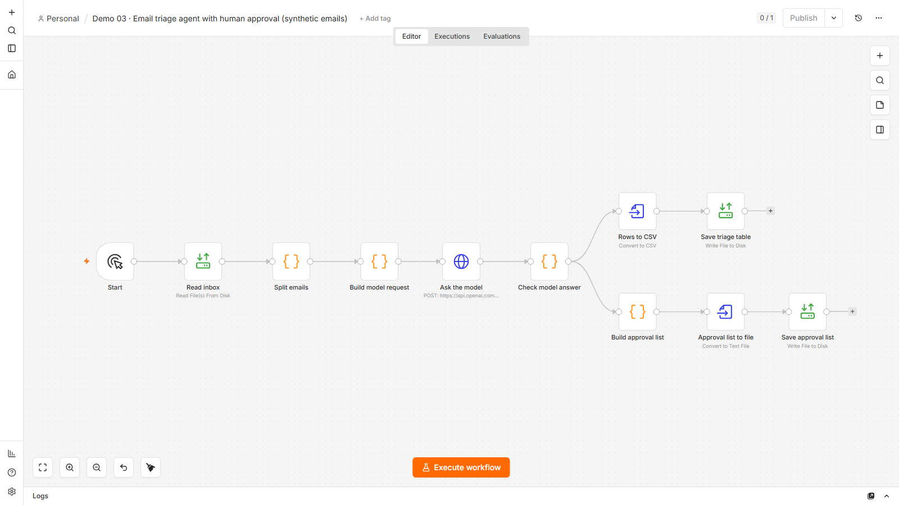
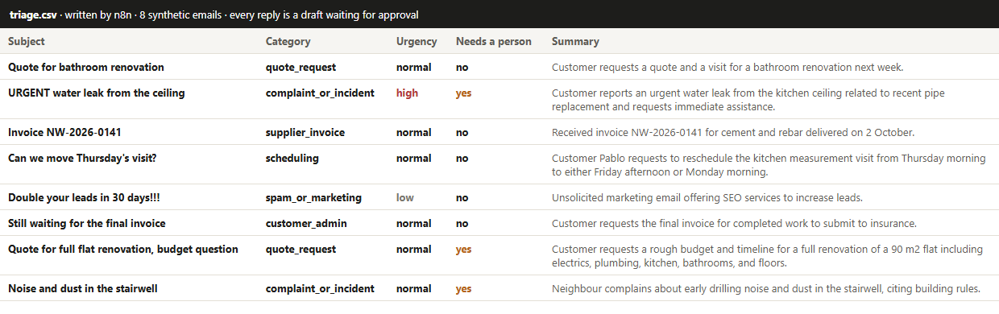

# Demo 03 · Email triage agent with human approval

**The problem:** the shared inbox mixes quote requests, complaints, supplier invoices, visit changes and spam. Someone reads everything, decides what matters, and writes the same replies again and again. Urgent things wait behind the rest.

**What this n8n workflow does:** an AI model sorts each email, rates its urgency, writes a one-line summary and drafts a reply. **Nothing is sent.** Every draft waits for a person, and the safety rules live in code, not in the model's goodwill.

## 1 · What goes in

8 emails for a small renovation company, all invented ([`samples/emails.json`](samples/emails.json), `example.com` addresses): two quote requests, a water leak, a supplier invoice, a visit change, a customer asking for an invoice, a neighbour complaining about noise, and marketing spam.

## 2 · The workflow



1. **Read inbox** and **Split emails**: one item per email.
2. **Build model request**: the instructions and a strict JSON schema, so the model can only answer with a category from the list, an urgency, a summary, a "needs a person" flag and a draft.
3. **Ask the model**: OpenAI `gpt-4.1-mini-2025-04-14`, temperature 0. The key is an n8n credential, never in the workflow file.
4. **Check model answer**, in code:
   - complaints and anything urgent **always** go to a person, whatever the model says;
   - an answer that does not fit the format becomes "other", goes to a person and gets no draft;
   - drafts never promise prices, dates or responsibility; they use placeholders like `[date]`.
5. A **triage table** (`triage.csv`) and an **approval list** (`drafts-for-approval.md`) with urgent emails first.

## 3 · What comes out



From the [approval list](example-output/drafts-for-approval.md):

> **🔴 URGENT water leak from the ceiling** · complaint_or_incident · high · needs a person
>
> *Hello, Thank you for informing us about the water leak…* (draft, waiting for approval)

## How it was tested

- **Without the model** (`test.js`, no key needed): the expected answers never reach the model; complaints and high urgency always go to a person; broken, off-list or wrongly typed answers become "other" with no draft; the approval list puts urgent emails first. Broken versions of these rules (mutants) make the tests fail.
- **With the model**, on the last real run: **category right in 8 of 8**, urgency right where it is unambiguous (the leak is high, the spam low), spam gets no reply, no draft contains a price or guesses the sender's title or gender, and no output file contains a key.
- **Honest limits:** 8 emails is a small test set, written by me. In a client project the test set is built from the client's real (anonymised) emails, and the agreement rate is measured before anything goes live.
- A first run greeted one sender as "Mr." from the email address alone. The instructions now forbid guessing a title or gender, and a test checks it.

## In a real project

- Trigger: Gmail or Outlook, new email in the shared inbox. Output: labels in the mailbox, a row in the CRM or a task, and the draft saved as a real email draft for one-click approval.
- The categories, the urgency rules and the reply tone come from the client.
- The model can be OpenAI or Claude, with the client's own API key. Cost here: about 4,400 tokens for the 8 emails (4,365 in the last run).

## Run it yourself

Needs Docker, Node and an OpenAI API key. From the repo root:

```bash
node demo-03-email-triage-agent/test.js                                   # rule tests (no key needed)
OPENAI_API_KEY=your-key sh demo-03-email-triage-agent/run-local.sh       # real run in a throwaway n8n container
node demo-03-email-triage-agent/test.js                                   # now also grades the real run
```

The key is passed to the container by name, turned into an n8n credential inside it, and gone when the container stops. The script refuses to keep any output file that contains a key. Tested with n8n 2.32.6.
